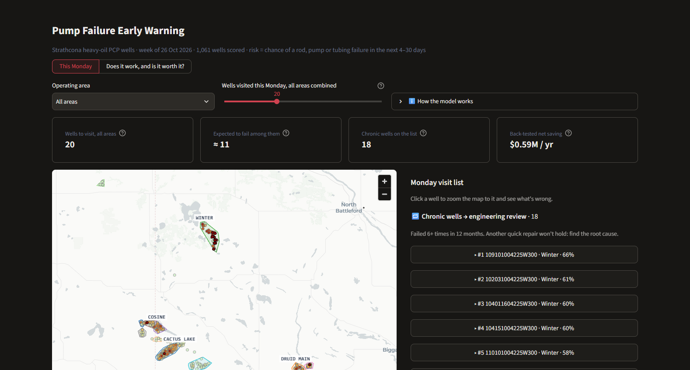

# Pump Failure Early Warning

**Team Neurons** · Regan, Naveen, Suhayb, Kashif · DSMLC Fall 2026 Datathon (Strathcona × Canary Labs)

| | |
|---|---|
| 🎥 **5-min summary video** | [youtu.be/X4oi_MgnKqE](https://youtu.be/X4oi_MgnKqE) |
| 📊 **Slides** | [slides.pdf](slides.pdf) |
| 💻 **Run the app** | `pip install -r requirements.txt` then `streamlit run app.py` |

## Research question
Can we predict which Strathcona heavy-oil wells will have a rod, pump or tubing failure in the next 4–30 days, and when is it cheaper to fix the problem before it breaks?

## Motivation
Pump failures cost Strathcona's heavy-oil wells about **$33M a year** (1,919 failures, Jun 2025–May 2026), and 28% come back within 30 days of the last repair. Field crews can only visit so many wells a week, so the real question is *which* wells. A ranked weekly list, with reasons, turns surprise breakdowns into planned work.

**Solution type: AI/ML prototype.** A LightGBM failure-risk model ranks every well each week, and a Streamlit app turns the ranking into a visit list for the field team: which wells to check, why, and what it saves.



## Quick start
```
pip install -r requirements.txt
streamlit run app.py
```
The app runs from the model outputs already in `outputs/`, so it doesn't need the raw data. To rebuild the model from scratch, see [Run it](#run-it).

## What the app does
- **This Monday:** a map of every well, coloured from light green (healthy) to dark red (likely to fail this month), and the weekly visit list in two groups:
  - **Chronic wells → engineering review.** Wells that failed 6+ times in 12 months; another quick repair won't hold.
  - **New warnings → field check.** Wells that aren't chronic but are at risk now; this is where the model beats a "most-failed wells" list.

  Click a well to zoom to it and see its warning signs (compared with its own normal), failure history, suggested action and cost.
- **Does it work, and is it worth it?** The back-test results in plain language, and sliders for visit cost, prevention rate and oil price that show the yearly saving.

## Key results
On a back-test over Jan–Sep 2026 (data the model never saw), every producing PCP well (about 1,000 a week) was scored once a week, on Mondays, by a model retrained on everything up to Nov 2025:

| Method | ROC AUC | Of the weekly top 25, share that failed within 4–30 days |
|---|---|---|
| Random ranking | 0.50 | 12% |
| Rule: wells with the most failures in the last 12 months | 0.70 | 46% |
| Logistic regression | 0.75 | 51% |
| LightGBM, pump signals only | 0.76 | 52% |
| **LightGBM, signals + history (final)** | **0.78** | **55%** |

- **About 4.5× better than picking wells at random**, and ahead of the best simple rule by **+7 to +13 points** (95% range, resampling the 38 test weeks).
- **Not one lucky year.** Retrained on all earlier years and tested on each year in turn, the model beats the rule every year: 41% vs 39% (2023), 43% vs 38% (2024), 48% vs 41% (2025), 55% vs 46% (2026).
- **Its probabilities are honest:** when it says 30%, about 30% of those wells fail.
- **Strongest in Winter (AUC 0.81), weakest in Cosine (0.68) and Bodo East (0.70).**
- **Failures cost about $33M a year.** Between Jun 2025 and May 2026 there were 1,919 logged failures: $23.5M in repair jobs plus 25,200 m³ of lost oil ($9.8M at a $61.60/bbl netback).
- **28% of failures come back within 30 days** of the last repair on the same well. Those repeats cost about $9.1M a year. The top 50 wells produce 21% of all failures.
- **Rods are three-quarters of failures.** A rod failure caught early saves about $8.9k, mostly in lost oil and in rig jobs that are no longer needed.
- **Acting on the top 20 wells a week nets about $0.6M a year** and warns of 23% of failures at least 4 days ahead (48% of visits find a real failure). This assumes $1,500 per visit and that half of the warned failures become planned work. With $500 visits it rises to about $1.6M; at $2,500 with 30% prevention it doesn't pay.
- **The model holds on the official failure log alone** (ROC AUC 0.78), so building labels from repair jobs didn't inflate the results.

## Data
Three files from the DSMLC Dataset Handbook. They are **not in this repo**, because the competition rules don't allow redistributing the dataset; put them in `data/` to rebuild the model.

| File | Grain | Used for |
|---|---|---|
| `daily_production.parquet` | well × day, 2021–2026 | pump signals (speed, torque, efficiency, current), oil, water, pressures, downtime, lost oil |
| `production_failures.parquet` | one row per failure, mid-2025 onward | official failure labels and failure type |
| `well_jobs.parquet` | one row per job, 2021–2026 | failure history before 2025 (repair jobs), repair cost (`field_est_total`) |

Outside source: Strathcona's Q3 2026 results, used for the netback ($99.47 sales − $22.97 royalties − $5.77 energy opex − $9.13 transport per boe = $61.60). Non-energy opex ($10.56) is left out because it's paid whether a pump runs or not. The dataset's wells produce about 21,000 bbl/d, in line with the "approximately 20 Mbbls / d" Strathcona reports for Lloydminster Conventional heavy oil.

## Method
- **A failure history back to 2021.** The failure log starts in mid-2025, but 99% of logged failures have a repair job within 3 days. Rod, pump and tubing repair jobs (which match a logged failure 64–96% of the time) stand in for failures before then. Log rows and job rows on the same well within 3 days are merged into one event.
- **One row per producing PCP well per Monday** (276k rows, 1,400 wells). The label is a failure 4–30 days later. The 4-day lead means the model gets no credit for spotting a well that is already down.
- **Features:** 7-day signals and their ratio to the well's own 90-day baseline; last-3-day jumps and 14-day trends in downtime, efficiency, torque and oil; operator speed changes; days since the last new rod string and pump change; downhole downtime codes, water cut, failure history, job spend, area, pump make, well age.
- **Validation by time:** train 2021–2024, tune 2025, test Jan–Sep 2026, with gaps longer than the label window between them. Each period is scored by a model trained only on earlier labels (walk-forward), plus a year-by-year test for 2023–2026.
- **No look-ahead:** weeks with a failure in the next 1–3 days are dropped from training only, never from the test.
- **Cost:** reactive cost = the actual repair job + lost oil around the failure × netback. Planned cost = the same job without escalation + downtime of a planned job. A walk-forward simulation acts on the top-*k* wells each week and counts each failure once.

## Project structure
```
├── app.py                              Streamlit app: weekly map + visit list, cost simulator, model check
├── pump_risk.py                        events, features, model, evaluation and cost logic (shared)
├── outputs/                            model, scores and test results written by pump_risk.py, read by the app
├── data/                               put the three raw parquet files here (not in the repo, see Data)
├── notebooks/00_exploratory.ipynb      first look at the data (missing values)
├── docs/app.png                        screenshot for this README
├── slides.pdf                          presentation slides
└── requirements.txt
```

## Run it
Just the app (uses the outputs in the repo):
```
pip install -r requirements.txt
streamlit run app.py
```
Rebuild everything from the raw data (needs all three files in `data/`):
```
python pump_risk.py          # builds outputs/ (a few minutes: it retrains for the year-by-year test)
streamlit run app.py
```

## Limitations
- Failures before mid-2025 come from repair jobs, so a few planned jobs may be counted as failures.
- Costs are field estimates; `actual_final_job_cost` is empty.
- The cost of an action and the share of failures it prevents are assumptions, shown with a sensitivity table.
- Daily averages hide short events. Rod torque is recorded on only about a quarter of well-days.
- The model is close to what daily data can predict: extra short-term and equipment features, recency weighting and tuning all moved the year-by-year result by about one point.
- The number of training rounds was tuned on 2025, and the feature set was checked on the 2023–2026 year-by-year test, so the 2025–2026 results are slightly optimistic.
- Warning signs in the app compare this week with the well's own 90-day normal. They are signs, not a confirmed diagnosis.

## External resources
- Strathcona Resources Q3 2026 results (netback per barrel), cited in Data above.
- Open-source libraries: LightGBM, DuckDB, pandas, scikit-learn, Streamlit, pydeck, Plotly. Base map tiles © OpenStreetMap contributors, © CARTO.

## AI disclosure
We used AI assistants (Claude) to help write and debug code (the DuckDB feature queries, the LightGBM training and walk-forward evaluation, and the Streamlit app), to review the validation for time-series leakage, and to draft and edit the README, charts and slide text. The team chose the research question and approach, checked the outputs, and verified the results and figures quoted here against the code and data.

## Next steps
- Pilot the weekly list in the Winter area for 8 weeks and record what the field team finds.
- Root-cause review for chronic wells, as a separate track from the weekly list.
- Plug into the Canary historian: read live well data from it, write each well's risk score back as a tag so operators see it on the screens they already use, and alarm when a well's risk jumps between weekly lists.
- Feed hourly torque and current from Canary instead of daily averages.
- A time-to-failure (survival) model for "when", and a failure-type model so the right crew is booked.
